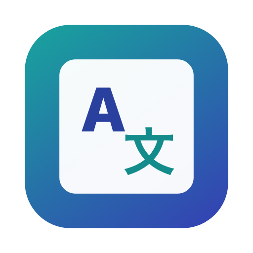

<p align="center">
  
  <h1 align="center">AI-Dict</h1>
  <h4 align="center">An AI learner's dictionary and translator for macOS</h4>
</p>

<p align="center">
<a href="https://github.com/FinnKyo/AI-Dict/blob/main/LICENSE"></a>
<a href="https://github.com/FinnKyo/AI-Dict/releases/latest"></a>

</p>

<div align="center">
<a href="./README_ZH.md">中文</a> &nbsp;&nbsp;|&nbsp;&nbsp; <a href="./README.md">English</a>
</div>

## About

AI-Dict is a menu bar dictionary and translator powered by the **free models** on
[OpenRouter](https://openrouter.ai). Look up a word and you get a fixed-layout
**learner's dictionary entry**. Look up a sentence and you get a clean translation.

It is built for language learners rather than as a plain translator. Each language has its
own template modelled on an established learner's dictionary. Every entry has the same
sections in the same order: pronunciation, part of speech, inflection, examples,
collocations, synonym distinctions and common-mistake notes.

AI-Dict is based on the open-source [Easydict](https://github.com/tisfeng/Easydict). It
keeps Easydict's windows, text selection, OCR and shortcuts, trimmed down to two jobs:
dictionary and translation.

## Features

- **Two query modes, chosen automatically**
  - **Single words** get a dictionary entry. This includes inflected and tensed forms such
    as `ran`, `食べられなかった` and `跑了`.
  - **Phrases and sentences** are translated.
- **Dedicated templates for 17 languages**: Chinese, Japanese, English, Korean, French,
  Italian, German, Spanish, Portuguese, Russian, Indonesian, Thai, Hindi, Malay, Vietnamese,
  Arabic and Bengali. For example:
  - English follows Oxford Advanced Learner's: UK and US IPA, inflections, CEFR and exam
    tags.
  - Japanese follows MOJi: kana, pitch accent, conjugation table and JLPT level.
  - German follows Duden: gender, plural, principal parts and case government.
- **Explained in your own language**: entries are always written in the "first language"
  set in Settings.
- **OpenRouter free models**
  - Refresh the live list of free models in Settings, with status, recent uptime and
    providers.
  - Test any single model and check your account quota.
  - One selected model is used at a time, or `openrouter/free` routes each request to any
    available free model.
- **No model "thinking"**: reasoning is disabled, so output starts streaming right away.
- **Input, selection and screenshot translation**: screenshot and silent OCR use Apple
  Vision on-device.
- Markdown-rendered results, mini and fixed windows, and pinnable windows.

## Install

1. Download `AI-Dict-x.y.z.dmg` from
   [Releases](https://github.com/FinnKyo/AI-Dict/releases/latest).
2. Open the DMG and drag **AI-Dict** into Applications.
3. On first launch, macOS may say the developer cannot be verified, because the app is not
   notarized by Apple. To open it anyway, do one of the following:
   - Click **Open Anyway** at the bottom of System Settings → Privacy & Security.
   - Or run:

     ```bash
     xattr -dr com.apple.quarantine /Applications/AI-Dict.app
     ```

## Getting started

1. **Add your API key.** Create a free key at
   [openrouter.ai/keys](https://openrouter.ai/keys). Then open the menu bar icon →
   Settings → Service and paste it in.
2. **Pick a model.**
   - Click Refresh to load the current free models.
   - Choose one with a green status, or keep `openrouter/free`.
   - Free models have a daily request limit: 50 per day, or 1000 per day once your
     account has bought at least $10 of credits.
3. **Grant permissions** in System Settings → Privacy & Security:
   - Accessibility, for selection translation.
   - Screen Recording, for screenshot OCR.
4. **Set your first language** in Settings → General. Dictionary entries are written in it.

### Default shortcuts

| Action | Shortcut |
|---|---|
| Input translation | ⌥ A |
| Screenshot translation | ⌥ S |
| Selection translation | ⌥ D |
| Show mini window | ⌥ F |
| Silent screenshot OCR | ⌥ ⇧ S |

When you select text with the mouse, a small query icon appears next to it; click it to
look the text up. By default the icon is not shown for text in your first language. You
can change this in Settings → Advanced.

## Build from source

Running the app needs macOS 13 or later. Build with the latest stable Xcode (the project
is developed on Xcode 27).

```bash
git clone https://github.com/FinnKyo/AI-Dict.git
```

```bash
cd AI-Dict && open Easydict.xcworkspace
```

In Xcode, select the **Easydict** scheme and press ⌘R. Open `.xcworkspace`, not
`.xcodeproj`.

Debug builds are ad-hoc signed by default. After every rebuild, macOS stops honouring the
Accessibility and other privacy permissions you granted earlier. To keep them, create
`Easydict-debug.local.xcconfig` in the project root (it is git-ignored) with your own
development certificate:

```
DEVELOPMENT_TEAM = <your Team ID>
CODE_SIGN_IDENTITY = Apple Development
CODE_SIGN_STYLE = Manual
```

## Credits and license

- AI-Dict is a modified version of [Easydict](https://github.com/tisfeng/Easydict). Thanks
  to tisfeng and all Easydict contributors.
- Like Easydict, it is released under [GPL-3.0](./LICENSE).
- Model access is provided by [OpenRouter](https://openrouter.ai). AI-generated entries can
  contain mistakes, so check important details against an authoritative dictionary.
