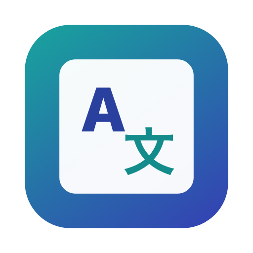

<p align="center">
  
  <h1 align="center">AI-Dict</h1>
  <h4 align="center">面向语言学习者的 macOS AI 辞典与翻译</h4>
</p>

<p align="center">
<a href="https://github.com/FinnKyo/AI-Dict/blob/main/LICENSE"></a>
<a href="https://github.com/FinnKyo/AI-Dict/releases/latest"></a>

</p>

<div align="center">
<a href="./README_ZH.md">中文</a> &nbsp;&nbsp;|&nbsp;&nbsp; <a href="./README.md">English</a>
</div>

## 简介

AI-Dict 是一款菜单栏辞典与翻译 App。它使用 [OpenRouter](https://openrouter.ai) 上的**免费模型**，
查单词时给出像有道、MOJi 那样固定版式的**学习者辞典释义**，查句子时给出简洁的翻译。

它不是普通的翻译工具，而是为学外语的人设计的：每种语言都有一套参考权威学习词典的专属模板，
发音、词性、变形、例句、搭配、近义辨析、易错提示等栏目一应俱全，每次查询版式都一样。

AI-Dict 基于开源项目 [Easydict](https://github.com/tisfeng/Easydict) 开发，沿用了它的窗口、
划词、OCR 和快捷键体系，并删减为只做辞典和翻译两件事。

## 功能

- **两种查询，自动判断**
  - **单词**：生成辞典条目，包括变形和时态，如 `ran`、`食べられなかった`、`跑了`。
  - **短语和句子**：直接翻译。
- **17 种语言的专属辞典模板**：中、日、英、韩、法、意、德、西、葡、俄、印尼、泰、印地、马来、
  越南、阿拉伯、孟加拉。例如：
  - 英语参考牛津高阶：英美音标、词形变化、CEFR 和考试标签。
  - 日语参考 MOJi：假名、声调核、活用表、JLPT。
  - 德语参考 Duden：性、复数、动词三形、支配格。
- **用你的母语解释**：辞典释义统一使用设置中的「第一语言」。
- **OpenRouter 免费模型**
  - 设置中可实时刷新免费模型列表，查看可用状态、近期在线率和提供方。
  - 可以单独测试某个模型，也能查看账户额度。
  - 一次只使用一个选定的模型；也可以用 `openrouter/free` 自动路由到可用的免费模型。
- **不让模型「思考」**：已关闭推理模式，结果几乎立即开始流式输出。
- **输入、划词、截图三种翻译方式**：截图和静默截图 OCR 使用系统自带的 Vision 识别。
- 结果以 Markdown 渲染，支持迷你窗口和固定窗口，也可以钉住窗口。

## 安装

1. 在 [Releases](https://github.com/FinnKyo/AI-Dict/releases/latest) 下载 `AI-Dict-x.y.z.dmg`。
2. 打开 DMG，把 **AI-Dict** 拖进「应用程序」文件夹。
3. 首次打开时，macOS 可能提示「无法验证开发者」。原因是 App 没有经过 Apple 公证。处理方法：
   - 在「系统设置 → 隐私与安全性」底部点击「仍要打开」；
   - 或者在终端执行：

     ```bash
     xattr -dr com.apple.quarantine /Applications/AI-Dict.app
     ```

## 开始使用

1. **填写 API Key**
   - 在 [openrouter.ai/keys](https://openrouter.ai/keys) 免费创建一个 Key。
   - 打开菜单栏图标 →「设置」→「服务」，填入 Key。
2. **选择模型**
   - 点击「刷新」获取当前的免费模型。
   - 选一个状态为绿色的模型，或保留 `openrouter/free`。
   - 免费模型每天的请求次数有限：账户未充值时每天 50 次，充值过 10 美元以上为每天 1000 次。
3. **授予权限**：到「系统设置 → 隐私与安全性」中开启：
   - 「辅助功能」：用于划词翻译。
   - 「屏幕录制」：用于截图 OCR。
4. **设置第一语言**：在「设置 → 通用」中设置，辞典释义会使用这个语言。

### 默认快捷键

| 操作 | 快捷键 |
|---|---|
| 输入翻译 | ⌥ A |
| 截图翻译 | ⌥ S |
| 划词翻译 | ⌥ D |
| 显示迷你窗口 | ⌥ F |
| 静默截图 OCR | ⌥ ⇧ S |

用鼠标选中文字后，旁边会出现一个查询图标，点击即可查询。如果选中的文字是你的第一语言，
默认不显示这个图标；可以在「设置 → 高级」中修改。

## 从源码构建

运行需要 macOS 13 以上；构建请使用最新正式版 Xcode（本项目在 Xcode 27 下开发）。

```bash
git clone https://github.com/FinnKyo/AI-Dict.git
```

```bash
cd AI-Dict && open Easydict.xcworkspace
```

在 Xcode 中选择 scheme「Easydict」，按 ⌘R 运行。注意要打开 `.xcworkspace`，不是 `.xcodeproj`。

调试版默认使用临时签名，每次重新编译后，macOS 会让之前授予的辅助功能等权限失效。
如果想让权限持续有效，可以在项目根目录新建 `Easydict-debug.local.xcconfig`（已被 git 忽略），
在其中填写你自己的开发证书：

```
DEVELOPMENT_TEAM = <你的 Team ID>
CODE_SIGN_IDENTITY = Apple Development
CODE_SIGN_STYLE = Manual
```

## 致谢与许可

- AI-Dict 修改自 [Easydict](https://github.com/tisfeng/Easydict)，感谢 tisfeng 及所有贡献者。
- 本项目与 Easydict 一样，以 [GPL-3.0](./LICENSE) 协议开源。
- 模型服务由 [OpenRouter](https://openrouter.ai) 提供，AI 生成的释义可能有误，请结合权威词典使用。
